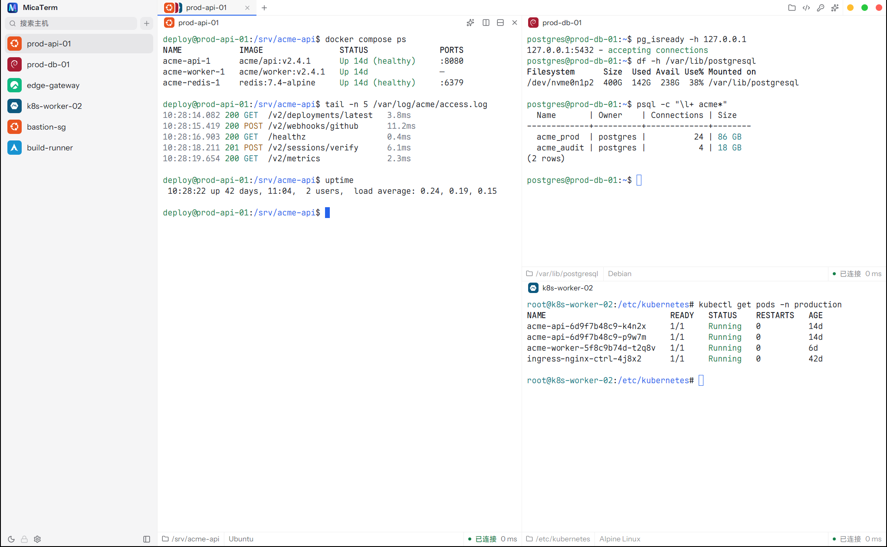
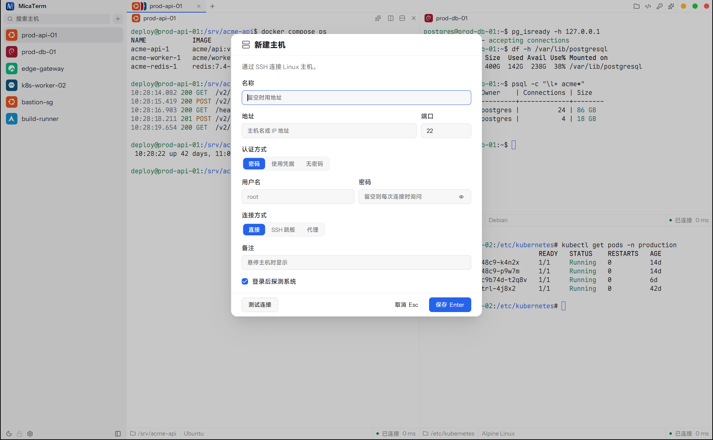
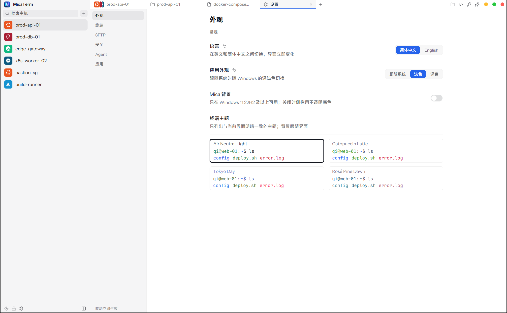
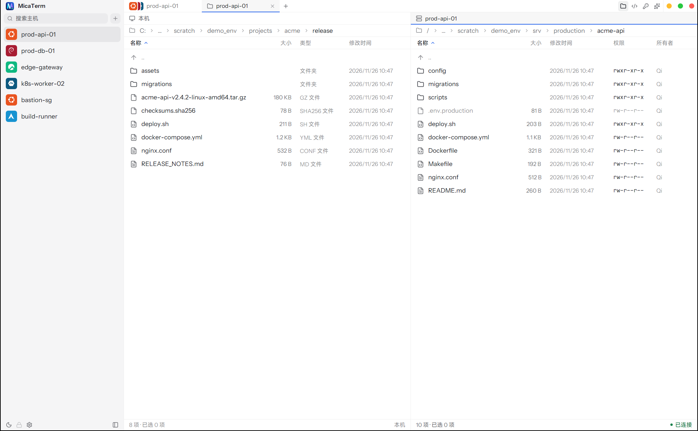
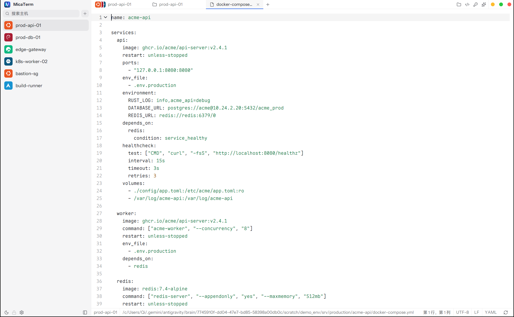
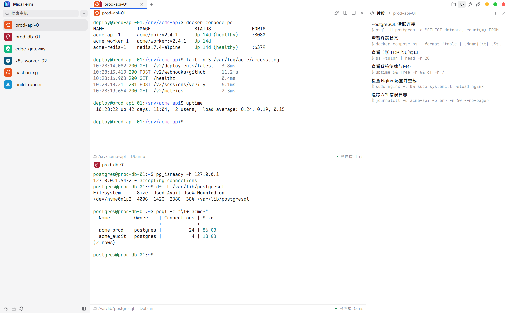
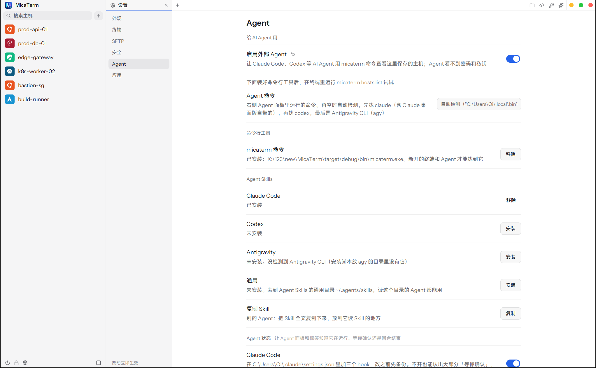

<div align="center">

<a href="https://github.com/qi1eat9fat/MicaTerm"></a>

# MicaTerm

### 面向现代运维与 AI 工作流的原生 SSH 桌面终端

**卡片分屏复用连接 · 双栏 SFTP 与内置远程编辑 · 本地加密保险库 · AI Agent 原生集成**<br>
基于 Rust 与 [GPUI](https://github.com/zed-industries/zed) 构建，便携化数据目录，原生适配 Windows 11。

[](https://github.com/qi1eat9fat/MicaTerm/releases/latest) [](https://github.com/qi1eat9fat/MicaTerm/stargazers) [](LICENSE)<br>
  

**[下载便携版](https://github.com/qi1eat9fat/MicaTerm/releases/latest)** &nbsp;·&nbsp; **[核心特性](#核心特性)** &nbsp;·&nbsp; **[AI Agent 集成](#ai-agent-集成)** &nbsp;·&nbsp; **[快捷键](#快捷键)** &nbsp;·&nbsp; **[从源码构建](#从源码构建)**

<br>

<picture>
  <source media="(prefers-color-scheme: dark)" srcset="assets/screenshots/workspace-dark.png">
  
</picture>

</div>

<br>

## 概览

MicaTerm 是一款以 SSH 主机管理为核心的原生桌面终端，面向高频多主机运维、远程文件操作以及与 AI 编程助手协同工作的工程场景。

| 设计维度 | 实现方式 |
| :-- | :-- |
| **卡片树分屏** | 每个标签页均为独立的可变比例分屏树；同主机分屏自动复用底层 SSH 连接与会话通道，对单通道堡垒机自动回退新建连接 |
| **运维闭环同屏** | 终端会话、WinSCP 风格双栏 SFTP 与 Tree-sitter 语法高亮远程编辑器集成于同一窗口，文件修改后按 `Ctrl+S` 经原连接原子写回 |
| **便携与安全边界** | 全部主机配置、设置、凭据索引及加密保险库存于程序同级 `data/` 目录，整目录可直接迁移；敏感信息经 Argon2id + ChaCha20-Poly1305 加密保护 |
| **AI Agent 协同** | 提供 `micaterm` CLI 与内置 Agent 侧边面板，供 Claude Code、Codex、Antigravity 等 Agent 安全操作已保存主机与交接终端，凭据始终隔离于保险库内 |

> 平台支持说明：当前版本已在 Windows 11 完整验证并发布便携构建；macOS 与 Linux 代码路径已预留，尚未完成实机验证。

## 快速开始

**1 · 获取便携版**

前往 [GitHub Releases](https://github.com/qi1eat9fat/MicaTerm/releases/latest) 下载 `MicaTerm-<版本>-windows-x86_64-portable.zip`，解压至具备普通写入权限的目录后直接运行 `micaterm.exe`。

<sub>便携包内置 <code>micaterm.exe</code>、<code>micaterm-cli.exe</code> 及空 <code>data/</code> 目录，全部持久化状态写入其中，请勿部署于 <code>C:\Program Files</code> 等只读目录。二进制已静态链接 C 运行库，无需预装 VC++ Redistributable，兼容 Windows LTSC；可通过环境变量 <code>MICATERM_DATA_DIR</code> 重定向数据目录。当前构建尚未包含代码签名，首次启动如遇 SmartScreen 提示，请选择「更多信息 → 仍要运行」。</sub>

**2 · 添加主机并连接**

点击左侧主机栏 `+` 或按下 `Ctrl+Shift+N` 创建主机，在同一表单内完成地址、认证方式与网络路由配置后保存，双击主机即可建立 SSH 会话。

**3 · 启用 AI Agent（可选）**

进入 **设置 → Agent**，开启 **启用外部 Agent**，按需一键安装 `micaterm` 命令行工具、对应 Agent 的 Skill 及状态 Hook。

## 核心特性

### 主机管理与多路连接

平铺式主机清单兼顾检索效率与视觉辨识度，所有连接参数、凭据引用与网络路由集中配置，减少多级目录切换成本。

<picture>
  <source media="(prefers-color-scheme: dark)" srcset="assets/screenshots/new-host-dark.png">
  
</picture>

| 能力 | 说明 |
| :-- | :-- |
| **主机清单与检索** | 登录后自动探测操作系统并展示发行版徽章（Ubuntu、Debian、Rocky、Alpine、Arch 等）；支持按名称、地址、用户名多关键词组合过滤及拖拽排序 |
| **认证机制** | 支持密码、共享凭据（密码 / 私钥 / SSH Agent）、无密码公钥与键盘交互式认证（自动应答常规提示，MFA / 验证码交由用户交互） |
| **网络路由** | 支持直连、多级 SSH 跳板机（Jump Host）以及 SOCKS5 / HTTP 代理转发 |
| **主机密钥与断线恢复** | 维护独立 `known_hosts` 信任库，首次连接二次确认指纹、密钥变更主动告警；连接中断后在卡片内按 `Enter` 即刻重连，并输出清晰的中文故障原因 |

### 卡片分屏与终端引擎

标签页以卡片树组织终端布局，配合基于被动转义序列解析的状态栏与现代终端协议支持，兼顾多机并发观测与低侵入性。

<picture>
  <source media="(prefers-color-scheme: dark)" srcset="assets/screenshots/settings-dark.png">
  
</picture>

- **灵活分屏与连接复用**：支持向右（`Ctrl+Shift+D`）或向下（`Ctrl+Shift+E`）拆分卡片，占位选择器支持快速复用当前主机连接、新建本地终端或切换至任意主机；拖拽分隔线实时调整比例，双击状态栏或按 `Ctrl+Shift+Enter` 临时最大化单张卡片。
- **低侵入状态感知**：卡片顶栏展示主机名与前台进程，底栏展示当前工作目录、操作系统、连接状态与实时 RTT 延迟。目录与进程信息完全通过被动解析 OSC 7 / 633 / 1337 / 3008 / 9;9 及窗口标题获取，不修改远端 Shell 配置文件，亦不额外开启轮询通道。后台标签存在新输出时显示绿点，任务结束或触发响铃时显示橙点。
- **现代终端协议**：支持 10,000 行回滚缓冲、智能大小写查找、`Ctrl+单击` 打开链接、OSC 52 剪贴板同步、Kitty 键盘协议与 OSC 9/777 桌面通知；本地终端自动探测 Shell（Windows 优先 PowerShell 7，依次回退 Windows PowerShell 与 `cmd.exe`），分屏时自动继承工作目录。
- **外观、主题与双语界面**：内置 **Air Neutral**、**Tokyo**、**Catppuccin**、**Rosé Pine** 四对浅色 / 深色主题，支持跟随系统外观与 Windows 11 22H2+ Mica 云母侧栏材质，并支持简体中文与英文界面即时切换。

### 双栏 SFTP 与内置远程编辑

无需切换外部传输工具，按下 `Ctrl+Shift+U` 即可在当前远程连接上打开双栏文件管理器，并直接编辑或预览远端文件。

<picture>
  <source media="(prefers-color-scheme: dark)" srcset="assets/screenshots/sftp-dark.png">
  
</picture>

<picture>
  <source media="(prefers-color-scheme: dark)" srcset="assets/screenshots/editor-dark.png">
  
</picture>

| 模块 | 能力详情 |
| :-- | :-- |
| **双栏传输管理** | WinSCP 风格本机 / 远端双栏视图，支持双向拖拽与从系统资源管理器拖入上传；内置并发传输队列（默认 3 并发，支持 1–10 调节）、断点续传、断线自动重连、冲突策略（覆盖 / 跳过）与递归权限修改 |
| **内置代码编辑器** | 选中远端文件按 `F4` 即刻编辑，内置行号、查找替换与 Tree-sitter 语法高亮（Bash、YAML、TOML、JSON、SQL、Python、Go、JavaScript、HTML、CSS、Markdown、Makefile、Diff 等）；`Ctrl+S` 经原连接写回并保留原文件属主、权限、BOM 与换行符（LF/CRLF），保存前自动校验外部变更冲突 |
| **内置文件预览** | 支持远端图片预览与 Markdown 渲染预览，便于直接核查日志附带资产与部署文档 |

### 凭据保险库与命令片段

将高频命令与共享认证材料从单台主机中解耦，在保证本地密钥安全边界的前提下提升日常排障效率。

<picture>
  <source media="(prefers-color-scheme: dark)" srcset="assets/screenshots/snippets-dark.png">
  
</picture>

- **加密保险库**：所有主机密码、私钥与口令均使用 **Argon2id** 密钥派生与 **ChaCha20-Poly1305** 认证加密存储于 `data/` 目录下，支持主密码保护并可选通过系统钥匙串（Windows 凭据管理器）在本机免密记忆数据密钥。
- **共享凭据与密钥生成**：凭据可被多台主机复用；支持导入密钥文件、粘贴私钥文本或现场生成 **Ed25519** / **RSA 4096** 密钥对。
- **跨主机命令片段**：右侧栏一键呼出（`Ctrl+Shift+S`），支持按单击仅输入或单击立即执行两种模式，精准发送至当前焦点终端卡片。

## AI Agent 集成

MicaTerm 将运行中的桌面客户端暴露为面向 AI Agent 的受控运维网关。Claude Code、Codex、Antigravity 等 Agent 通过 `micaterm` 命令行工具与运行中的 MicaTerm 经当前用户专属本地通道通信，在不接触任何明文凭据的前提下完成远端巡检、命令执行、文件同步与主机管理。

<picture>
  <source media="(prefers-color-scheme: dark)" srcset="assets/screenshots/settings-agent-dark.png">
  
</picture>

| 集成能力 | 机制与安全边界 |
| :-- | :-- |
| **凭据零暴露** | 所有 SSH 登录与 SFTP 传输均由运行中的 MicaTerm 代为完成，明文密码与私钥永不离开保险库，也不通过 CLI 返回；保险库处于锁定状态时自动提示用户解锁 |
| **内置 Agent 面板** | 标签栏右侧入口可在窗口内直接运行 Claude Code、Codex 或 Antigravity CLI（留空自动探测路径，兼容 Claude 桌面版内置 CLI）；启动前支持选择工作目录及续接 Claude Code 历史对话 |
| **终端交接（Hand to Agent）** | 在任意远程卡片右键选择「交给 Agent」，即可将已通过 MFA / 单次登录验证的堡垒机终端交由 Agent 接管（`exec --card`、`cards read`、`cards send-key`），操作全程在用户视野内可见，随时可「收回 Agent」立即终止权限 |
| **状态识别与 Skill 分发** | **设置 → Agent** 支持一键安装 `micaterm` 命令至 `PATH`、安装 Claude Code / Codex / Antigravity / 通用 `~/.agents/skills` Skill 及状态 Hook；在面板折叠时仍可识别「运行中 / 等你确认 / 回合结束」并发送桌面通知 |

常用命令示例（支持管道自动输出 JSON 或显式指定 `--json`）：

```bash
# 查看当前运行环境、已交接卡片及可用子命令
micaterm env

# 检索主机并执行远端命令 / 文件同步
micaterm hosts list -q prod --json
micaterm exec <host-id> "docker compose ps"
micaterm upload <host-id> ./dist /srv/acme-api/dist
micaterm sync <host-id> ./release /srv/acme-api --delete

# 操作用户交接的实时远程卡片（适用于单登录堡垒机场景）
micaterm cards list --json
micaterm cards read <card-id> --lines 120
micaterm exec --card <card-id> "systemctl status nginx --no-pager"
```

<sub>在 MicaTerm 内置本地终端中会自动注入 <code>TERM_PROGRAM=micaterm</code>、<code>MICATERM_SELF_CARD</code> 与 <code>MICATERM_CLI</code> 环境变量。Windows 下原始可执行文件为 <code>micaterm-cli.exe</code>，安装至 <code>PATH</code> 后自动注册为 <code>micaterm</code>。完整参数与协议说明可通过 <code>micaterm --help</code> 查阅。</sub>

## 快捷键

Windows / Linux 统一采用 `Ctrl+Shift` 组合，保留全部单 `Ctrl` 组合键供终端内 Shell 使用；macOS 对应 `⌘` 体系。

<details>
<summary><b>展开查看完整快捷键表</b>（窗口、标签、分屏卡片、终端与 SFTP）</summary>

<br>

| 操作 | Windows / Linux | macOS |
| :-- | :-- | :-- |
| 新建本地终端标签 | `Ctrl+Shift+T` | `⌘T` |
| 新建主机 | `Ctrl+Shift+N` | `⌘N` |
| 聚焦主机搜索 | `Ctrl+Shift+H` | `⌘⇧H` |
| 显示 / 隐藏左侧主机栏 | `Ctrl+Shift+B` | `⌘B` |
| 打开双栏 SFTP | `Ctrl+Shift+U` | `⌘⇧U` |
| 打开 / 收起命令片段面板 | `Ctrl+Shift+S` | `⌘⇧S` |
| 打开设置 | `Ctrl+,` | `⌘,` |
| 切换标签页 | `Ctrl+Tab` / `Ctrl+Shift+Tab` | 同左 |
| 跳转至第 1–9 个标签 | `Ctrl+Shift+1`…`9` | `⌘1`…`9` |
| 向右 / 向下分屏 | `Ctrl+Shift+D` / `Ctrl+Shift+E` | `⌘D` / `⌘⇧D` |
| 关闭当前卡片 | `Ctrl+Shift+W` | `⌘W` |
| 最大化 / 还原当前卡片 | `Ctrl+Shift+Enter` | `⌘⇧Enter` |
| 在分屏卡片间移动焦点 | `Alt+方向键` | `⌥⌘+方向键` |
| 调整分屏分隔线比例 | `Alt+Shift+方向键` | `⌃⌘+方向键` |
| 复制 / 粘贴 | `Ctrl+Shift+C` / `Ctrl+Shift+V` | `⌘C` / `⌘V` |
| 终端内查找 | `Ctrl+Shift+F`（`F3` / `Shift+F3` 跳转） | `⌘F`（`⌘G` / `⌘⇧G`） |
| 清空屏幕 | `Ctrl+Shift+K` | `⌘K` |
| 调整终端字号 | `Ctrl+=` / `Ctrl+-` / `Ctrl+0` | `⌘=` / `⌘-` / `⌘0` |
| SFTP 文件操作 | `F4` 编辑 · `F5` 传输 · `F2` 重命名 · `F9` 属性 · `Delete` 删除 | 同左 |

</details>

## 从源码构建

### 构建依赖

- **Rust 工具链**：版本由 [`rust-toolchain.toml`](rust-toolchain.toml) 锁定，安装 [rustup](https://rustup.rs) 后首次构建将自动拉取。
- **Windows 编译环境**：Visual Studio 2022 生成工具（「使用 C++ 的桌面开发」）、[CMake](https://cmake.org) 与 [NASM](https://www.nasm.us)（供 `aws-lc-sys` 编译加密后端）。

### 构建与测试

```bash
# 开发运行（独立数据目录位于 target/debug/data/）
cargo run

# 发布构建（产物位于 target/release/micaterm.exe 与 micaterm-cli.exe）
cargo build --release --bin micaterm --bin micaterm-cli

# 运行完整测试套件（含 GPUI 界面测试与进程内 SSH/SFTP 测试服务器）
cargo test --workspace
```

<details>
<summary><b>项目结构与自动化发布流程</b></summary>

<br>

#### 工作区模块

| 路径 | 职责 |
| :-- | :-- |
| `src/` | 窗口壳、卡片分屏树、主机管理、SFTP 标签、内置编辑器、设置页、保险库与 Agent 面板 |
| `src/cli/` | `micaterm` 外部 CLI、本地 IPC 服务端、Agent Skill 及状态 Hook 集成 |
| `crates/micaterm-terminal/` | 终端仿真引擎、GPU 渲染视图、主题配色与本地 PTY 管理 |
| `crates/micaterm-ssh/` | SSH 协议会话、认证与跳板/代理路由、主机密钥校验与 SFTP 传输引擎 |
| `crates/micaterm-hosts/` | 主机 / 凭据 / 命令片段领域模型、SQLite 存储层与加密保险库 |
| `crates/micaterm-ui/` | 跨模块复用的通用界面组件与右键菜单 |
| `locales/` | 简体中文与英文多语言文案资源 |
| `tests/ui/` | 基于 GPUI 测试框架的端到端界面测试 |

#### 发布流程

推送与 `Cargo.toml` 版本号一致的 `v<版本号>` 标签即可触发 [GitHub Actions 发布工作流](.github/workflows/release.yml)，自动完成静态 CRT 依赖校验、便携包打包、SHA-256 校验文件生成与 GitHub Release 发布（含 `-` 预发布后缀的版本自动标记为 Pre-release）：

```bash
git tag v2.0.0 && git push origin v2.0.0
```

</details>

## 许可证与致谢

本项目基于 **[GPL-3.0](LICENSE)** 开源协议发布。

- 终端、SSH 与主机存储模块源自 [shell-rs](https://github.com/since2006/shell-rs) 并深度重构裁剪，原 MIT 许可与版权声明保留于各子 crate 的 `LICENSE` 文件中。
- Agent 屏幕状态识别规则改写自 [Pebrel](https://github.com/Kuddev/pebrel)（GPL-3.0）。
- 内置界面字体 [Instrument Sans](assets/fonts/InstrumentSans-OFL.txt) 与等宽字体 [JetBrains Mono](assets/fonts/OFL.txt) 遵循 SIL OFL 1.1；操作系统品牌图标来自 [Simple Icons](https://simpleicons.org)（CC0）。

<sub>注：本文档展示截图中的主机地址、目录结构与终端输出均为隔离测试环境下生成的演示数据。</sub>

<br>

<div align="center">

<a href="https://star-history.com/#qi1eat9fat/MicaTerm&Date">
  <picture>
    <source media="(prefers-color-scheme: dark)" srcset="https://api.star-history.com/svg?repos=qi1eat9fat/MicaTerm&type=Date&theme=dark">
    
  </picture>
</a>

</div>
