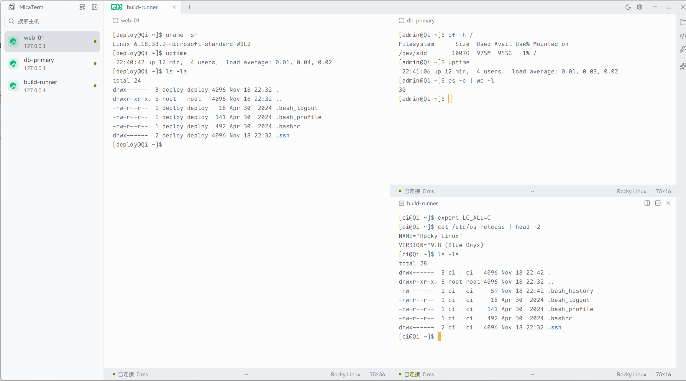
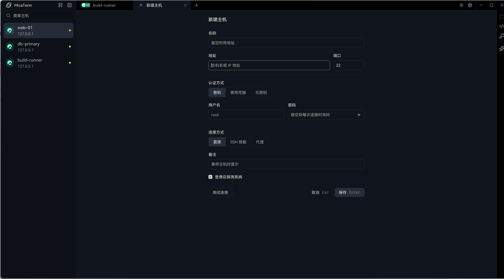
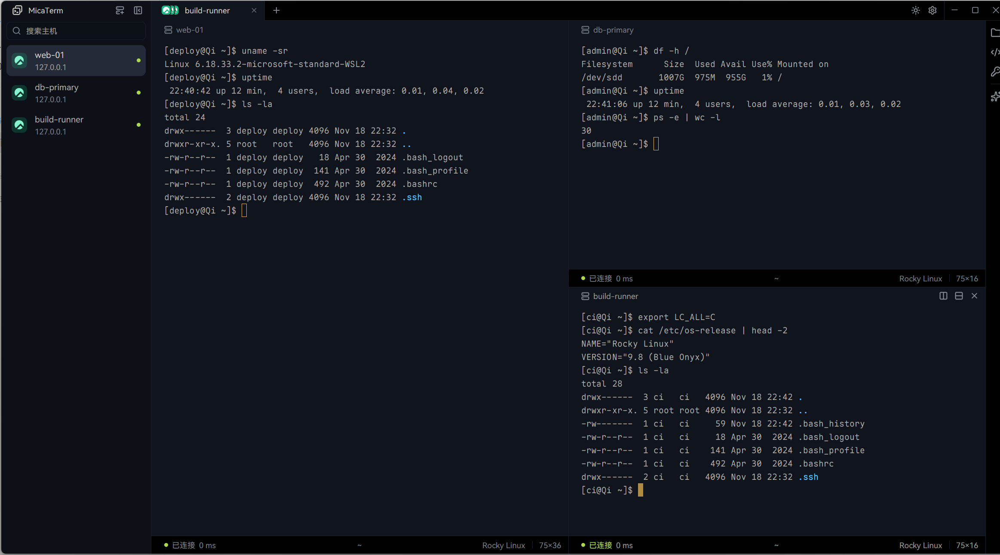
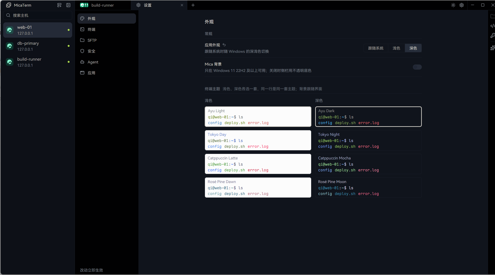
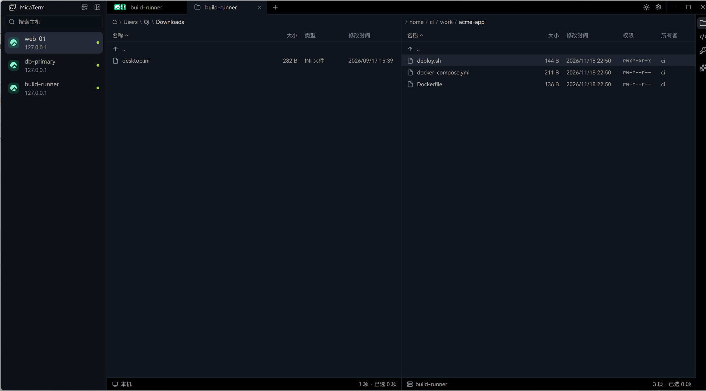
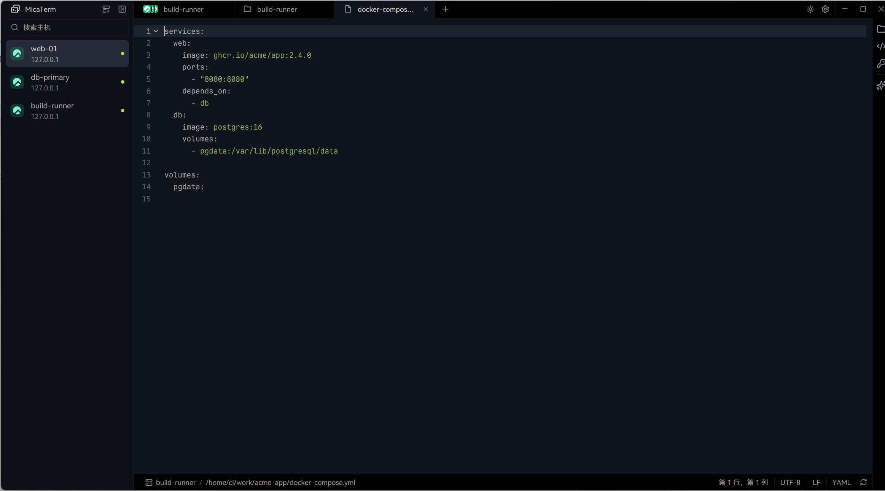

# MicaTerm

以 SSH 主机管理为核心的桌面终端。Rust + [GPUI](https://github.com/zed-industries/zed)（gpui-kit），Windows 优先。



**核心设计**

- **卡片分屏**：一个标签是一棵卡片树。同一主机分屏时复用已有连接，只新开 shell 通道。
- **终端、SFTP、远程编辑同屏**：双栏传输，文件在内置编辑器修改后 Ctrl+S 写回。
- **便携**：主机、凭据、设置全部位于程序旁的 `data/` 目录，整个目录可直接迁移；秘密加密存入保险库。
- **供 AI Agent 使用**：`micaterm` 命令供 Claude Code、Codex 操作已保存的主机和终端，密码与私钥不出保险库。

> 仅在 Windows 11 上验证。macOS 与 Linux 的代码路径存在，尚未实测。

## 目录

- [功能](#功能)
- [给 AI Agent 用](#给-ai-agent-用)
- [下载与使用](#下载与使用)
- [常用快捷键](#常用快捷键)
- [从源码构建](#从源码构建)
- [发布](#发布)
- [项目结构](#项目结构)
- [许可](#许可)

## 功能

### 主机与连接

- 平铺主机列表：系统徽章（登录后自动探测）、搜索（名称 / 地址 / 用户名，多词同时匹配）、拖动排序、连接状态
- 认证方式：密码、密钥、SSH Agent、无密码。键盘交互式认证自动应答，验证码等问题转交用户
- 连接方式：直连、跳板机、SOCKS5 / HTTP 代理
- 独立 known_hosts：首次连接确认主机密钥，密钥变化时告警
- 断线后按 Enter 在卡片内重连；错误信息为中文并说明原因



### 标签与卡片

- 标签即分屏树：向右 / 向下分屏后出现占位卡片，选择同主机的新终端、本地终端或其他主机
- 拖动分隔线调整比例；双击状态栏将单张卡片放大到整个标签；卡片可移入新标签
- 远程卡片分屏复用连接；仅支持单通道的堡垒机自动新建连接
- 本地卡片分屏在同一目录打开新终端
- 卡片顶行显示名称与前台程序；底部状态栏显示连接状态、延迟、当前目录、系统与尺寸
- 目录与前台程序来自远程 OSC 7 / 633 / 1337 / 3008 / 9;9 序列及窗口标题的被动解析；不写远程 rc 文件，也不额外开通道查询进程
- 后台卡片有输出时标签显示绿点，结束或响铃时显示橙点



### 终端

- 10000 行回滚、智能大小写查找、Ctrl+单击打开链接、OSC 52 剪贴板、kitty 键盘协议、OSC 9/777 通知
- 本地 shell 自动检测（Windows 优先 PowerShell 7），支持手动指定
- 内置 Ayu、Tokyo、Catppuccin、Rosé Pine 四对浅色 / 深色主题；应用外观跟随系统或固定
- Windows 11 22H2 及以上支持 Mica 背景



### SFTP 与编辑

- WinSCP 式本地 / 远程双栏：拖放上传下载（含从资源管理器拖入）、传输队列、断点续传、断线自动重连
- 冲突时覆盖 / 跳过；属性中可修改权限（支持递归）
- 内置编辑器：行号、查找替换、常见语言语法高亮；Ctrl+S 经原连接写回，保留所有者、权限、BOM 与 CRLF；保存前检查文件是否被外部修改
- 图片预览、Markdown 预览





### 凭据与保险库

- 凭据可被多台主机共用；密钥来自文件、粘贴，或现场生成 Ed25519 / RSA 4096
- 密码、口令、私钥以 Argon2id + ChaCha20-Poly1305 加密存入数据目录的保险库，由主密码保护；可选「在本机记住」，数据密钥存入系统钥匙串
- 主密码可留空：此时秘密仅由本机钥匙串保护，迁移到其他电脑需重新输入

### 命令片段

- 跨主机共用的命令文本，单击输入或直接执行，发往焦点卡片

> 截图中的主机、文件与终端输出均为演示数据。

## 给 AI Agent 用

Claude Code、Codex 等 Agent 通过 `micaterm` 命令操作已保存的主机：列出 / 查看主机、执行命令、上传 / 下载 / 同步文件、增删改主机与凭据。命令经运行中的 MicaTerm 登录；密码与私钥保留在保险库，Agent 无法读取；保险库锁定时请求用户解锁。

**启用**：设置 › Agent › 启用外部 Agent。同一页可将命令行工具安装到 PATH（便携版安装至程序旁 `bin\`），并为 Claude Code、Codex 安装 Skill。

**Agent 面板**：右侧图标栏最下方的「Agent」在 MicaTerm 内运行 Claude Code 或 Codex。命令在设置 › Agent 中配置，留空则自动检测（包括 Claude 桌面版自带的 claude）。启动前选择工作目录与对话，Claude Code 可续接该目录中的历史对话。缺少总开关、命令行工具或 Skill 时，启动框会列出并提示补齐。

**状态**：面板标题与图标栏显示 Agent 是否在运行、等待确认、回合已结束；等待确认且面板不可见时发送通知。设置 › Agent 可为 Claude Code、Codex 安装状态 hook；未安装时也能从屏幕识别大部分「等待确认」。

**交给 Agent**：远程卡片右键「交给 Agent」，将当前终端交给面板中的 Agent。Agent 通过 `exec --card` 在该卡片执行命令（适用于仅允许一次登录的堡垒机），通过 `cards read` 读取屏幕；「收回」后权限终止。Agent 亦可运行在 MicaTerm 之外的终端：未配置 Agent 命令时卡片仍可交出，Agent 用 `micaterm cards list` 找到卡片。

**环境变量**：MicaTerm 内的本地终端带有 `TERM_PROGRAM=micaterm`、`MICATERM_SELF_CARD`、`MICATERM_CLI`；Agent 运行 `micaterm env` 可获知自身位置与可用能力。

```bash
micaterm env
micaterm hosts list
micaterm exec <主机 ID> "df -h /"
micaterm upload <主机 ID> ./dist /tmp/dist
micaterm cards list
micaterm exec --card <卡片 ID> "uptime"
micaterm cards read <卡片 ID> --lines 50
```

主机 ID 位于主机右键菜单的「复制 ID」；卡片 ID 来自 `micaterm cards list`。命令用法见 `micaterm <命令> --help`；输出到管道或加 `--json` 时为 JSON。Windows 上命令为压缩包内的 `micaterm-cli.exe`，安装到 PATH 后名为 `micaterm`。

## 下载与使用

从 [Releases](../../releases) 下载 `MicaTerm-<版本>-windows-x86_64-portable.zip`，解压到有写入权限的目录，运行 `micaterm.exe`。

- 压缩包包含空的 `data/` 目录，全部配置写入其中；整个目录可迁移到其他电脑
- `micaterm-cli.exe` 供 AI Agent 使用（见上节），不使用 Agent 时可忽略
- 不要放在 `C:\Program Files` 等普通权限不可写的目录
- 已静态链接 C 运行库，无需安装 VC++ 运行库，LTSC 版 Windows 可直接运行
- 暂未签名，首次运行时 SmartScreen 可能提示「未知发布者」，选择「更多信息 → 仍要运行」

环境变量 `MICATERM_DATA_DIR` 可将数据目录指向其他位置。

## 常用快捷键

Windows / Linux 使用 Ctrl+Shift 组合，单独 Ctrl 的组合全部留给终端；macOS 使用 ⌘。

| 操作 | Windows / Linux | macOS |
|---|---|---|
| 新建本地终端标签 | Ctrl+Shift+T | ⌘T |
| 新建主机 | Ctrl+Shift+N | ⌘N |
| 搜索主机 | Ctrl+Shift+H | ⌘⇧H |
| 显示 / 隐藏主机栏 | Ctrl+Shift+B | ⌘B |
| 打开 SFTP | Ctrl+Shift+U | ⌘⇧U |
| 命令片段 | Ctrl+Shift+S | ⌘⇧S |
| 设置 | Ctrl+, | ⌘, |
| 切换标签 | Ctrl+Tab / Ctrl+Shift+Tab | 同左 |
| 跳到第 N 个标签 | Ctrl+Shift+1…9 | — |
| 向右 / 向下分屏 | Ctrl+Shift+D / Ctrl+Shift+E | ⌘D / ⌘⇧D |
| 关闭卡片 | Ctrl+Shift+W | ⌘W |
| 放大 / 还原卡片 | Ctrl+Shift+Enter | ⌘⇧Enter |
| 在卡片间移动焦点 | Alt+方向键 | ⌥⌘+方向键 |
| 移动分隔线 | Alt+Shift+方向键 | ⌃⌘+方向键 |
| 复制 / 粘贴 | Ctrl+Shift+C / Ctrl+Shift+V | ⌘C / ⌘V |
| 终端内查找 | Ctrl+Shift+F，F3 / Shift+F3 | ⌘F，⌘G / ⌘⇧G |
| 清屏 | Ctrl+Shift+K | ⌘K |
| 终端字号 | Ctrl+= / Ctrl+- / Ctrl+0 | ⌘= / ⌘- / ⌘0 |

SFTP 文件列表：F4 编辑、F5 上传 / 下载、F2 重命名、F9 属性、Delete 删除。

## 从源码构建

依赖：

- Rust：版本由 [`rust-toolchain.toml`](rust-toolchain.toml) 固定，安装 [rustup](https://rustup.rs) 后首次构建自动下载
- Windows：Visual Studio 2022 生成工具（「使用 C++ 的桌面开发」）、[CMake](https://cmake.org)、[NASM](https://www.nasm.us)（`aws-lc-sys` 需要）

```bash
cargo run
```

```bash
cargo build --release
```

产物位于 `target/release/micaterm.exe`。开发版数据位于 `target/debug/data/`，与日常使用的数据相互独立（`cargo clean` 会一并删除，需要保留时先备份）。

运行全部测试（包含用 GPUI 测试框架驱动真实窗口壳的界面测试，以及进程内 SSH 测试服务器）：

```bash
cargo test --workspace
```

## 发布

推送 `v<版本号>` 标签即触发 [GitHub Actions 发布流程](.github/workflows/release.yml)：

1. 核对标签与 `Cargo.toml` 的版本号一致
2. 在 Windows 上构建 release 版，检查两个程序均不依赖 VC++ 运行库
3. 打包便携版 zip（`micaterm.exe`、`micaterm-cli.exe`、空 `data/` 目录）并生成 SHA-256 校验文件
4. 创建 GitHub Release 并上传；版本号含 `-`（如 `1.3.0-beta.1`）的标记为预发布

```bash
git tag v1.2.0
```

```bash
git push origin v1.2.0
```

在 Actions 页面手动运行该流程时，仅构建打包并上传 artifact，不创建 Release。

## 项目结构

```
src/                    窗口壳、卡片分屏、主机、SFTP 标签、编辑器、设置、保险库、Agent 面板
src/cli/                micaterm 命令行（供 AI Agent 使用）及其与应用间的通道
crates/
  micaterm-terminal/    终端引擎、终端视图、本地 PTY
  micaterm-ssh/         SSH 连接、登录、代理、SFTP 传输
  micaterm-hosts/       主机 / 凭据 / 命令片段模型与数据库、保险库加密
  micaterm-ui/          应用与终端共用的界面组件
locales/                界面文案
assets/                 字体、图标、标志、README 截图
tests/ui/               界面测试
```

## 许可

[GPL-3.0](LICENSE)。

终端、SSH、主机等模块源自 [shell-rs](https://github.com/since2006/shell-rs) 并裁剪改造，原 MIT 部分的许可与版权声明保留在各 crate 的 `LICENSE` 中。Agent 状态的屏幕识别规则改写自 [Pebrel](https://github.com/Kuddev/pebrel)（GPL-3.0）。内置字体 JetBrains Mono 采用 [SIL OFL 1.1](assets/fonts/OFL.txt)，系统徽章来自 [Simple Icons](https://simpleicons.org)（CC0）。
